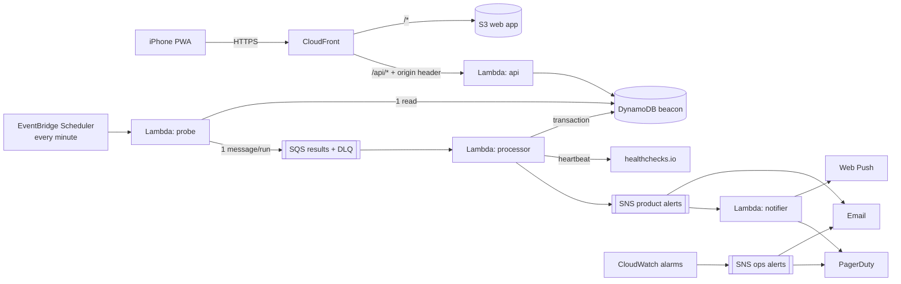

# Beacon

A personal uptime and incident monitor for every live product I run, with an installable iPhone app (PWA) and push alerts.
It checks each product every minute, opens an incident after consecutive failures, alerts the phone (Web Push), email and PagerDuty, and shows uptime, latency and incident history.

Runs entirely on AWS serverless inside the free tier: Lambda, DynamoDB, SQS, SNS, EventBridge Scheduler, S3 and CloudFront, all managed with Terraform and deployed by GitHub Actions over OIDC.

> Work in progress. `HANDOVER.md` is the full specification; `docs/` holds ADRs, runbooks and RCAs.

## Local development

```bash
make setup    # Python 3.12 venv + dev dependencies (needs uv)
make lint test
make web      # frontend typecheck, lint, test, build
```

## Architecture



Design decisions are in [`docs/adr/`](docs/adr/); the full specification is [`HANDOVER.md`](HANDOVER.md).

## First deploy (M4 checkpoint)

Prerequisites: AWS CLI v2.32+ (`brew install awscli`), Terraform ≥ 1.10, `uv`, and an admin sign-in for the CLI: `aws login --profile beacon --region ap-south-1` (browser sign-in, short-lived credentials, no access keys), then `export AWS_PROFILE=beacon`.

Brand-new AWS accounts must be verified by AWS Support before CloudFront resources can be created. Open an "Account and billing" case early if your account is new.

```bash
# 1. Bootstrap (once): state bucket, GitHub OIDC role, $1 budget
cd infra/bootstrap
terraform init
terraform apply -var alert_email=you@example.com
cd ../..

# 2. Build the Lambda zips
make build

# 3. Main stack (CloudFront takes ~5-10 minutes to create)
export TF_STATE_BUCKET=<state_bucket output from step 1>
export TF_VAR_alert_email=you@example.com
make plan
make apply

# 4. Secrets (after the first apply: Terraform creates placeholders, this overwrites them)
make vapid          # keep the public key for the web build; paste the private key below
make secrets

# 5. Check
curl -s "$(terraform -chdir=infra/main output -raw cloudfront_url)/api/health"   # {"status":"ok",...}
curl -s -o /dev/null -w "%{http_code}\n" "$(terraform -chdir=infra/main output -raw api_function_url)api/health"   # 403

# 6. Demo product
.venv/bin/python scripts/seed_demo.py \
  --app "$(terraform -chdir=infra/main output -raw cloudfront_url)" \
  --target "$(terraform -chdir=infra/main output -raw demo_target_url)"
```

Confirm the SNS subscription emails (product alerts and ops alerts) and the AWS Budgets email when they arrive.

## Web app

```bash
cd web
npm ci
npm run dev:mock      # fake data, no AWS needed: http://localhost:5173 (any password)
BEACON_API_ORIGIN=https://<cloudfront domain> npm run dev   # against the real API
```

## Install on iPhone (M5 checkpoint)

```bash
export VITE_VAPID_PUBLIC_KEY=<public key from `make vapid`; must pair with the private key in SSM>
make deploy-web       # build, sync to S3, invalidate CloudFront
```

1. On the iPhone, open the CloudFront URL in **Safari** → **Share** → **Add to Home Screen**.
2. Open **Beacon from the Home Screen** (not Safari) and log in. The installed app has its own storage.
3. **Settings → Enable notifications → Allow.** Settings should then show Push: 1 device.
4. **Send test notification.** A push ("🔔 Beacon test notification") and an email arrive within seconds.

## CI/CD setup (M6 checkpoint)

CI (`.github/workflows/ci.yml`) runs on every PR and branch push. Deploys (`deploy.yml`) run on every push to `main`: CI, then your approval, then OIDC into AWS, `terraform plan` + `apply`, web publish, and a smoke test. No AWS keys are stored in GitHub.

1. Create the repo **JeyaViknan/beacon** on GitHub, **public** (required-reviewer approvals are free only on public repos). Don't add a README, .gitignore or licence; the repo already has them.
2. **Settings → Environments → New environment** `production`:
   - **Required reviewers:** add yourself.
   - **Deployment branches and tags:** *Selected branches* → `main`.
3. **Settings → Secrets and variables → Actions**:

   | Kind | Name | Value |
   |---|---|---|
   | Variable | `AWS_DEPLOY_ROLE_ARN` | `terraform -chdir=infra/bootstrap output -raw deploy_role_arn` |
   | Variable | `AWS_REGION` | `ap-south-1` |
   | Variable | `TF_STATE_BUCKET` | `terraform -chdir=infra/bootstrap output -raw state_bucket` |
   | Variable | `VITE_VAPID_PUBLIC_KEY` | the value in `web/.env.local` (public key, not secret) |
   | **Secret** | `ALERT_EMAIL` | your alert email (a secret so logs mask it) |

4. Push, then approve the run under **Actions → Deploy → Review deployments**:
   ```bash
   git remote add origin git@github.com:JeyaViknan/beacon.git
   git push -u origin main
   ```
